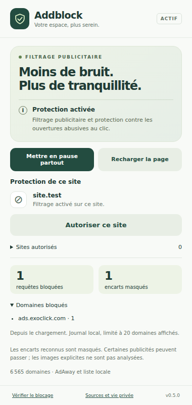

# Addblock

A Chrome Manifest V3 extension that filters advertising requests, hides recognized ad placements, and limits pop-ups triggered by hijacked clicks. A personal browser development and security project built with JavaScript, HTML, and CSS.

## Features in version 0.5.1

- **6,565 unique domains** combining 6,540 AdAway entries and 34 local entries (9 overlaps), including their subdomains.
- Targeted hiding of explicitly marked ad placements and images/frames from filtered domains. Dynamically inserted elements are supported.
- Pop-up protection based on the destination and whether the opening is directly related to a user action.
- Global pause, per-site exceptions, and restoration of hidden elements when protection is disabled.
- Per-tab counters and a blocked-domain log stored only for the browser session. Detailed network activity is available when the extension is loaded in developer mode.



The extension interface, demo, and screenshot are currently in French. The documentation and code comments are in English.

## Install in Chrome

1. Extract `dist/addblock-0.5.1.zip` into a permanent folder, or use the source directory for development.
2. Open `chrome://extensions` and enable **Developer mode**.
3. Select **Load unpacked**, then choose this folder (the one containing `manifest.json`).
4. Pin Addblock and reload any websites that were open before installation.

Installing the extension does not require Node.js or Python. Chrome 111 or later is required. After an update, click **↻** in `chrome://extensions`, accept any requested permissions, and reload your pages.

## Local demo

```sh
python3 -m http.server 8080 --directory demo
```

Open `http://localhost:8080` in Chrome with Addblock loaded. The page contains a fake sidebar ad, a click that attempts to open an unwanted tab, and a button that opens a legitimate window. Pause protection to compare the behavior. The demo does not contact any advertising server; it demonstrates element hiding and pop-up protection rather than network filtering.

In the source/development build, the extension's **Vérifier le blocage** (Check blocking) page tests Chrome's engine with seven simulated requests without contacting the target domains. The automated tests also exercise real requests to a local server.

## Development and testing

Requirements: Node.js 20+, npm, and Python 3.10+.

```sh
npm ci
npx playwright install chromium
npm test
```

On Linux, install Chromium's system dependencies if needed with `npx playwright install-deps chromium`.

| Suite | Coverage |
|---|---|
| `npm run check` | Exact list reconstruction, parsing, invalid entries, and incomplete downloads |
| `npm run test:network` | Requests blocked before reaching the server, normal content, pause, exceptions, and persistence |
| `npm run test:cosmetics` | Ad placements, preserved content, DOM changes, style restoration, counters, and log cleanup |
| `npm run test:popups` | 28 scenarios covering links, forms, sign-in flows, keyboard actions, downloads, embedded frames, and exceptions |
| `npm run test:demo` | Behavior of the local demo included in the project |
| `npm run test:release` | Extracted distribution ZIP: blocking, badge, hiding, pause, privacy page, and restricted diagnostics |

Test browsers use temporary profiles. Test domains resolve to a local server, so no real advertisements are loaded. Network reports and screenshots are written to a temporary directory whose path is printed. The GitHub Actions workflow runs the same checks on every push and pull request.

## Architecture

```text
vendor/adaway/hosts.txt + rules/base-domains.json
                    ↓ scripts/filters.py
           rules/advertising.json
                    ↓
          Chrome's native network engine

popup.js ←→ background.js ←→ popup-bridge.js (isolated world)
                │                  ├── cosmetics.js: hiding / restoration
                │                  └── popup-guard.js: window opening checks
                └── statistics.js: counters in storage.session
```

The blocklist is bundled with the extension. Network filtering remains active when the Addblock popup is closed. Pause and exception settings are dynamic rules persisted by Chrome. The service worker synchronizes page scripts after a settings change. A site exception also applies to its subdomains and embedded frames.

The pop-up guard runs in the page's JavaScript context to intercept `window.open`. Configuration handling and element hiding run in an isolated context. No remote code is executed.

## Update the domain list

```sh
npm run filters:update  # Explicitly download the AdAway source
npm run check
npm test
```

Review list changes before distributing an update. `npm run filters:build` rebuilds the rules offline from the bundled copy. `rules/sources.json` contains domain counts and the source's SHA-256 checksum. Clearly incomplete downloads are rejected. The extension does not automatically update the list in the browser.

## Permissions and data

| Permission | Purpose |
|---|---|
| `declarativeNetRequest` | Block requests and manage exceptions |
| `declarativeNetRequestFeedback` | Development source only; omitted from the distribution ZIP |
| `activeTab` | Identify the selected website when the popup is opened |
| HTTP/HTTPS access | Intercept window openings and hide ad placements on pages |
| `storage` | Temporarily keep counters in `storage.session` |
| `webNavigation` | Reset counters on navigation and identify documents |

No account or telemetry is used. In the development build, the log contains domain names, not full URLs or page content. It is reset on navigation and removed when the tab closes. The browser clears session storage when it closes. The log stores up to 100 domains per tab and displays 20. Exceptions and the global pause setting persist across sessions.

Chrome restricts detailed DNR events to unpacked extensions with the feedback permission. The distribution ZIP omits this permission and does not collect a detailed network log, even when loaded unpacked; the native badge remains usable. Simulated diagnostics explain that they require the source/development build. A request count is not the same as an advertisement count.

## Known limitations

- Domain lists do not cover every advertisement and can block useful functionality. AdAway also includes some analytics services.
- Cosmetic selectors are deliberately specific. Unrecognized ad placements or overlays may remain visible; entire sidebars are not removed.
- An unknown destination opened by an explicit button can be allowed. The pop-up guard does not block redirects within the current tab.
- A legitimate window opened after a lengthy asynchronous operation may be blocked. Allowing the site restores its behavior.
- The interception code shares the page's JavaScript context, so a page can attempt to bypass it. Configuration is applied asynchronously during loading. This protection is not a security boundary.
- No AI model analyzes or blurs explicit images.
- Test results cover controlled scenarios, not a measured blocking rate across the web.

## Sources and attribution

The [AdAway](https://github.com/AdAway/adaway.github.io/) list is used under **CC BY 3.0**, with attribution, a preserved source copy, and a description of the adaptations in [THIRD_PARTY_NOTICES.txt](THIRD_PARTY_NOTICES.txt). The source file retains its contributor notices. The generated rules also cover subdomains, unlike exact hosts-file resolution.

The extension code and tests were written for this project; no files were copied from `sarthak-here/addblocker`. Using a credited community blocklist does not imply authorship of its data. The project's own code is licensed under [MIT](LICENSE); the third-party list retains CC BY 3.0.

## Present the project on a resume

Adapt this example to your own contribution and what you can explain:

> Developed a Chrome MV3 ad-filtering extension with network rules, pop-up protection, dynamic DOM filtering, per-site exceptions, and automated integration tests in Chromium.

In an interview, demonstrate protection versus pause, a test proving that a request never reaches the server, an avoided false positive, and the permission model's limitations. Clearly explain your own contributions, the third-party list, and any assistance received during the project.

## Share a release

```sh
npm run release
```

The build validates local HTML links and version consistency, verifies the filter
source, and writes these deterministic archives to `dist/`:

- `addblock-0.5.1.zip`: runtime extension, installation instructions, privacy policy,
  licenses and filter attribution; no development tools or debug-feedback permission.
- `addblock-0.5.1-source.zip`: source, tests, demo, CI, and documentation for GitHub.
- `SHA256SUMS.txt`: archive hashes for checking downloads.

Browser-generated `_metadata`, node_modules, caches and local test profiles are
excluded. The runtime ZIP has `manifest.json` at its root. Do not install the source
and runtime builds simultaneously. Updating in the same installation directory
preserves the extension identity; loading a new directory may create a separate
installation and separate settings.

The source UI remains French; documentation, privacy policy and code comments are
English. The in-extension Sources et vie privée link now opens a working page.

This is a shareable manual-install release, **not a published Chrome Web Store
extension**. Store submission still requires the owner's developer account,
listing details, hosted privacy-policy URL and review. The local [privacy policy](PRIVACY.md)
is ready to host. No public deployment or Store submission has been performed.

## Validation for 0.5.0

On 2026-10-28, all suites passed with Chromium 156.0.8078.4 and Node.js 22.22.1:
7 Python checks plus network, cosmetics, 28 popup scenarios, demo and distribution
integration suites. Controlled integration tests exercise actual network blocking, pause,
site exceptions and persistence, 28 popup scenarios, cosmetic restoration and
session counts, the demo, and the extracted release archive. A positive result
means the specified scenarios passed; it is not a general effectiveness claim
for YouTube ads, all adult ads, all overlays, or every website.

## Outlook Web advertising rows (0.5.1)

On outlook.live.com, outlook.office.com and outlook.office365.com, Addblock
also hides message-list option rows containing a separate exact Pub, Ad,
Advertisement or Publicité badge. This is a conservative DOM heuristic, not
a mailbox filter: no messages are moved, deleted or categorized. It does not
block Revolut or other advertisers' ordinary websites or emails.

Global pause and site exceptions restore hidden rows. Dynamic badge changes
and recycled rows are handled. Unsupported layouts or languages may remain
visible; ambiguous plain-text badges can still cause false positives. Pause
Addblock on the site if a legitimate row disappears.

Run `npm run test:outlook` for synthetic browser regression checks covering
host isolation, normal messages, dynamic updates and restoration. The actual
signed-in Outlook layout still needs a user check; a screenshot alone does
not provide its DOM structure.
